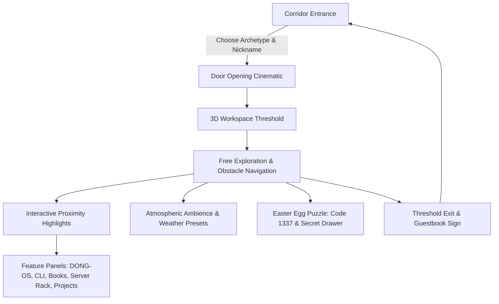

# GAME_DESIGN.md — Mechanics & Spatial Experience Design

## 1. Core Vision
"A portfolio you don't scroll. You explore."
THE ROOM reimagines the traditional, static CV/portfolio website as an explorable, cozy, low-poly 3D creative workstation. Visitors don't read passive text blocks; they enter through a private corridor, select their visitor persona, ring the doorbell, and step inside a living digital office where every piece of furniture, monitor, book, and device is an interactive portal to the engineer's real-world work.

---

## 2. Visitor Journey Loop

---

## 3. Spatial Zones & Layout
The workspace measures **14m (width) x 12m (depth) x 4.2m (height)**:
1. **The Entrance Threshold (Z = 4.5m to 5.8m)**:
   - Door portal, exit sequence button, and visitor guestbook sign panel.
2. **The Developer Workstation (X = -4.7m, Z = -3.7m)**:
   - Solid walnut desk, dual displays (`desk.main_monitor` & `desk.secondary_monitor`), mechanical keyboard (`desk.keyboard`), desk lamp (`desk.lamp`), coffee mug (`desk.coffee`), smartphone stand (`desk.phone`), and passcode lockbox drawer (`secret.drawer`).
3. **The Technical Knowledge Library (X = -0.2m, Z = -4.7m)**:
   - 6-volume interactive bookshelf covering Systems, Web, Cloud, AI, Hardware, and Problem Solving.
4. **The Core Edge Infrastructure Corner (X = +4.7m, Z = -4.0m)**:
   - 42U server cabinet with pulsing LEDs, network router, and interactive edge topology telemetry.
5. **The Architectural Project Wall (X = +6.93m, Z = -4.5m to +0.5m)**:
   - 4 framed posters highlighting 3D Web, Edge Cloud, AI Agents, and Full-Stack case studies.
6. **The Lounge & Entertainment Area (X = +4.5m, Z = +0.7m to +4.5m)**:
   - Sectional sofa (supports sitting behavior), coffee table with FAQ panel, wall-mounted Smart TV.
7. **The Panoramic Skyline Window (X = -5.8m to -6.8m, Z = -3.0m to +3.0m)**:
   - Floor-to-ceiling glass wall looking out over dynamic weather skybox with clear, sunset, rain, and night presets.

---

## 4. Visitor Identity Archetypes
Visitors choose from 8 personas before entering:
- **Recruiter / Talent Lead 💼**: Prioritizes CV, production projects, and direct contact channels.
- **Technical Partner 🤝**: Emphasizes serverless edge architecture, network diagrams, and code quality.
- **Close Friend ☕**: Highlights coffee trivia, developer jokes, and casual hacks.
- **General Explorer 🧭**: Balanced introduction to all areas.
- **Stealth Hacker 🥷**: Prompted to inspect terminal hints and unlock the secret drawer.
- **Phantom Observer 👻**: Hovering transparent ethereal presence.
- **Cybernetic Android 🤖**: Futuristic robotic avatar with glowing cyan visor.
- **Mystery Guest 🎭**: Theatrical mask and enigmatic presence.

---

## 5. Controls & Camera Mechanics
- **Desktop**:
  - `W, A, S, D` or `Arrow Keys`: Walk (3.2 m/s).
  - `Shift`: Sprint (5.6 m/s).
  - `Left Click + Drag`: Orbit follow camera yaw and pitch.
  - `Mouse Wheel`: Zoom camera distance between 2.2m and 6.0m.
  - `E`: Contextual interaction with nearby highlighted objects.
  - `Escape`: Close modals, exit sofa sit, or exit window lookout mode.
- **Mobile & Tablet**:
  - Left virtual analog joystick: 360° omnidirectional movement.
  - Right touch drag surface: camera look and swipe rotation.
  - On-screen `TAP TO INTERACT` button: contextual action.
- **Accessibility Fallback**:
  - Dedicated **2D View** button instantly renders a complete WCAG 2.1 accessible HTML portfolio with zero 3D/WebGL requirement.
